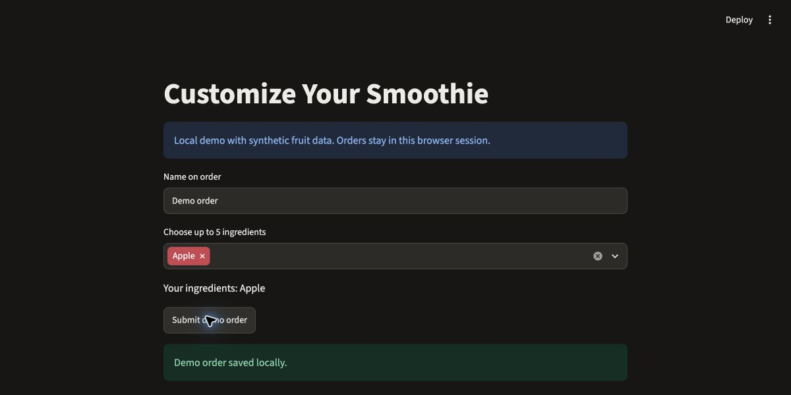

# Smoothie Order App

A Streamlit learning project for choosing fruit ingredients and storing orders in Snowflake.

## Local demo

```sh
python -m venv .venv
source .venv/bin/activate
python -m pip install streamlit pandas requests
SMOOTHIE_DEMO=1 streamlit run streamlit_app.py
```

The demo uses synthetic fruit data and keeps orders only in the browser session. It needs no database or external nutrition service.

## Connect Snowflake

Install `requirements.txt`, configure Streamlit's private `connections.snowflake` settings, and run without `SMOOTHIE_DEMO`. The expected tables are `smoothies.public.fruit_options` (`FRUIT_NAME`, `SEARCH_ON`) and `smoothies.public.orders` (`ingredients`, `name_on_order`). Keep connection settings outside Git. The live path also requests fruit nutrition information.

## Checked status

An offline test confirms that order values are bound as query parameters, including names containing quotes and SQL-like text. Live Snowflake access and nutrition service availability were not tested.

```sh
python -m unittest test_orders -v
```

[Detailed project notes](docs/project-guide.md)


